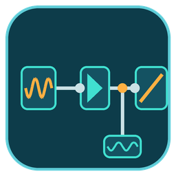
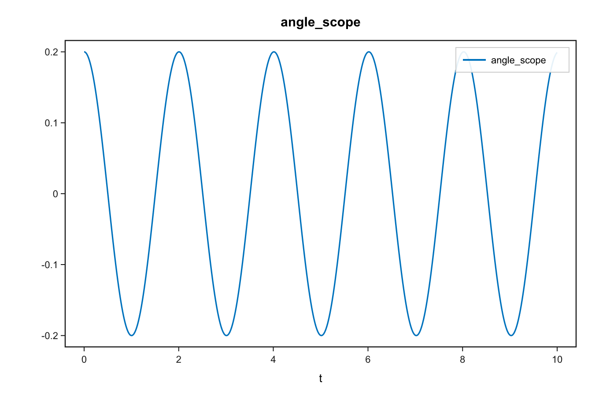

<!-- markdownlint-disable MD033 MD041 -->
<p align="center">
  
</p>

<h1 align="center">SimCraft</h1>

<p align="center">
  <b>A block-diagram simulation workbench; open source, agent-drivable, built in pure Rust.</b><br>
  Typed signals, algebraic-loop detection, adaptive solvers — with a<br>
  <a href="https://github.com/NibrasAz7/matcraft">MatCraft</a> session underneath, the way Simulink interlocks with MATLAB.<br>
  macOS · Windows · Linux · the web
</p>

<p align="center">
  
  
  
  
  
  <br>
  <a href="https://remade.wiki/projects/simcraft/"></a>
</p>

<br>

<p align="center">
  
  <br>
  <sub><code>pendulum.simcraft</code> run headless — the <code>angle_scope</code> figure is a real <code>matplot</code> figure, produced by the same pipeline as MatCraft's.</sub>
</p>

<p align="center">
  <a href="#quick-start">Quick start</a> ·
  <a href="#highlights">Highlights</a> ·
  <a href="#why-it-exists">Why</a> ·
  <a href="#the-matcraft-interconnection">MatCraft</a> ·
  <a href="#inside">Inside</a> ·
  <a href="#whats-next">What's next</a> ·
  <a href="#sibling-projects">Siblings</a> ·
  <a href="#license">License</a>
</p>

---

## Community

SimCraft follows the conventions of the [ArtCraft](https://getartcraft.com) family of clean-room Rust apps. Come say hello, get help and follow development:

- **Source:** [github.com/NibrasAz7/simcraft](https://github.com/NibrasAz7/simcraft)
- **The workspace it lives in:** [github.com/NibrasAz7/matcraft](https://github.com/NibrasAz7/matcraft)

## Quick start

```console
cargo run -p simcraft-cli -- run examples/pendulum.simcraft   # simulate a model headless
#   ran 10000 steps (rk4, dt=0.001) · angle_scope: 10001 samples over [0, 10]
cargo run -p simcraft-cli -- control 7979                    # JSON-lines TCP channel
cargo run -p simcraft-cli -- mcp                             # MCP server on stdio
cargo run -p simcraft-studio                                 # the diagram editor
```

## Highlights

<table>
<tr>
<td width="33%" valign="top">

### Real simulation

Typed directed graphs, continuous + discrete states, fixed-step `euler`/`rk4` and adaptive `rk45` Dormand–Prince with error control — signals validated before `t=0`, never mid-run.

</td>
<td width="33%" valign="top">

### MatCraft underneath

One linked M-code session is the model's compute context: callbacks, parameter sweeps, From/To Workspace — `out = sim('pendulum.simcraft')` returns a struct you can `plot` immediately.

</td>
<td width="33%" valign="top">

### Everything is a command

Every UI action is a command id reachable from the headless CLI, the TCP control channel and MCP — automation-first, no account, no telemetry.

</td>
</tr>
</table>

---

## Why it exists

There is no open-source Simulink-class tool. Octave covers the language side (GPL); the modeling/simulation side has nothing a student or indie developer can reach without a MathWorks license. SimCraft fills that gap — a dynamic-systems modeler with the same MIT/Apache licensing, the same automation-first design, and the same "everything is a command" architecture as its sibling apps.

**Status:** `cargo test` green — `simcore` graph/solver, 25 blocks, `.simcraft` JSON models, engine + MCP + Studio. Honest scope: genuinely useful educational and indie simulation — pendulums, control loops, filters, discrete controllers. Not first-release goals: full Simulink parity, state machines, masked libraries, code generation, hardware-in-the-loop.

## The MatCraft interconnection

Simulink is useful because MATLAB can drive it; SimCraft is designed the same way. One linked MatCraft session is the model's compute context.

### M-code drives models

```matlab
out = sim('pendulum.simcraft')                    % run, get logged outputs
set_param('pendulum/Integrator', 'x0', 0.2)       % set a block parameter
g   = get_param('pendulum/Gain', 'K')             % read a parameter
add_block('simcraft/Sources/Sine', 'pendulum/w1') % edit the model
add_line('pendulum', 'w1/1', 'Gain/1')            % wire it
```

`sim` returns a struct: `out.t` (time vector), `out.y`/`out.scope1` (logged signals), `out.x` (final states), `out.stoptime`, `out.stats`. Sinks can also write values straight into the workspace.

### Shared infrastructure, nothing duplicated

| Concern          | Shared from                                                      |
| ---------------- | ---------------------------------------------------------------- |
| Matrices, linalg | `matcore` (`Matrix`, `CMatrix`, `SparseMat`)                     |
| Values, M-code   | `matlang` (`Session`, `Value`)                                   |
| Scopes, plots    | `matplot` (a Scope block is a streaming `Figure`)                |
| Command registry | `engine` conventions (`sim.run`, `model.set_param`, …)           |
| Automation       | `mcp` protocol + TCP control channel, same JSON-lines framing    |
| File exchange    | `.mat` v5 (load/save for logged data), `.simcraft` model files   |
| UI chrome        | `ui-egui` patterns: docked panes, ribbon, control server, themes |

## Inside

```text
simcore   (L1) graph, ports, solver, scheduler — pure Rust, no egui
simblocks (L2) the block library (built on simcore traits)
simmodel  (L2) .simcraft file format, load/save/validate
engine    (L5) command registry: sim.run, model.*, block.*, wire.*, scope.*
ui-egui   (L6) diagram canvas, palette, scope panes, console (matlang)
mcp       (L6) MCP server for agents
apps/simcraft       desktop Studio (eframe)
apps/simcraft-cli   headless run/export: simcraft run model.simcraft
```

- **simcore** — typed ports (`double`, `complex`, integer widths, `bool`), topological execution each step, algebraic-loop detection (error or Newton iterate), flat `x` vector owned by the solver, multirate `Ts` scheduling, zero-crossing bracketing.
- **`.simcraft` format** — UTF-8 JSON, diff-friendly; blocks keyed by hierarchical path, wires as `{src, dst}` port pairs, solver/settings/callbacks inline; `model.check` reports unreachable blocks, unconnected ports, width/rate mismatches.
- **The block library (~25)** — step, ramp, sine, constant, clock · scope, to-workspace · gain, sum, product, abs, saturation, dead-zone, switch · relational and logical operators · integrator, derivative, transfer-fcn, PID, transport-delay · unit-delay, zero-order-hold · mux, demux.
- **Studio** — family chrome (ribbon, docks): palette left, hit-tested canvas center, inspector right, MatCraft console bottom; scopes pop out as matplot figure tabs.

## What's next

`ROADMAP.md` tracks milestones — multirate/zero-crossing rigor, subsystems, M-function blocks, WASM, stiff solvers (`ode15s`-style BDF), S-function API.

## Sibling projects

SimCraft is built in the ArtCraft tradition — original, clean-room, Rust-native. It runs inside [MatCraft](https://github.com/NibrasAz7/matcraft), its numerical-computing sibling.

## License

MIT OR Apache-2.0. Clean-room: public Simulink documentation and published solver literature only; no MathWorks code, assets, icons, file formats, or observed-behaviour capture from MathWorks software. Block *names* and documented semantics are public knowledge; every implementation here is our own. Non-code assets are tracked in `ASSETS.md`.
